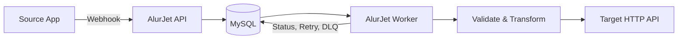

# AlurJet

> **A lightweight, self-hosted integration engine for connecting APIs, transforming data, and reliably processing events through declarative workflows.**

AlurJet adalah proyek open-source berbasis **Go + Fiber + MySQL** untuk menerima webhook, memvalidasi payload JSON, mengubah field, dan mengirimkannya ke HTTP API lain. Eksekusi diproses di background, memiliki retry dan riwayat status yang bisa diperiksa.

> **Status: blueprint / belum merupakan aplikasi siap pakai.** Repository ini saat ini memuat rancangan dan contoh dokumentasi. Command, endpoint, contoh respons, dan konfigurasi berikut adalah **kontrak implementasi yang ditargetkan**, bukan klaim fitur sudah berjalan. Tandai satu per satu setelah diimplementasikan.

## Fitur MVP (target v0.1.0)

- Flow linear: `webhook -> validate -> transform -> HTTP request` lewat YAML.
- Management API untuk membuat, memperbarui, dan melihat flow.
- MySQL untuk menyimpan flow, execution sebagai antrean, dan riwayat percobaan.
- Background worker dengan retry terbatas, DLQ status, dan replay manual.
- Admin API key dan token webhook unik per flow, dikelola lewat konfigurasi server.
- JSON logs, Swagger API docs, unit/integration tests, Docker Compose.

**Belum termasuk:** visual builder, Kafka/NATS, multi-tenant, RBAC, plugin SDK, distributed tracing, dan connector selain HTTP.

## Ilustrasi alur



## Quickstart (setelah aplikasi tersedia)

Persyaratan: Docker dan Docker Compose. Siapkan konfigurasi dan jalankan service:

```bash
cp .env.example .env
# Ganti key, token, kedua password MySQL, dan periksa origin tujuan.
docker compose up --build -d
curl --fail http://localhost:8080/healthz
```

Berikutnya ikuti [Panduan cepat](docs/getting-started/quickstart.md) untuk mengimpor flow, mengirim webhook, dan memeriksa hasilnya. Contoh flow ada di [`docs/examples/order-to-api.yaml`](docs/examples/order-to-api.yaml).

## Dokumentasi

Mulai dari [indeks dokumentasi](docs/README.md) untuk melihat panduan integrasi, referensi, dan operasional.

| Kebutuhan | Dokumen |
|---|---|
| Mulai dari nol dan coba flow pertama | [Panduan cepat](docs/getting-started/quickstart.md) |
| Memahami flow, execution, retry, dan DLQ | [Pelacakan execution](docs/guides/tracking-executions.md) |
| Menulis konfigurasi YAML | [Konfigurasi flow](docs/guides/flow-configuration.md) |
| Endpoint dan format request/response | [Referensi API](docs/reference/api.md) |
| Struktur code, database dan layer | [System Design](SYSTEM_DESIGN.md) |
| Masalah umum dan solusinya | [Pemecahan masalah](docs/operations/troubleshooting.md) |
| Tahapan implementasi & batasan MVP | [Roadmap](ROADMAP.md) |
| Menyiapkan pekerjaan agent implementasi | [Paket kerja agent](docs/ai/implementation-plan.md) dan [AGENTS.md](AGENTS.md) |
| Meninjau perubahan blueprint | [Changelog](CHANGELOG.md) |
| Menilai pekerjaan setelah MVP | [Backlog setelah MVP](docs/post-mvp.md) |

## Tech stack

- Go, Fiber (HTTP controller), Clean Architecture pragmatis: **Controller -> Usecase -> Repository**.
- MySQL (flow storage dan durable queue sederhana).
- `slog` untuk logging; Swaggo untuk Swagger UI.
- Docker Compose untuk demo lokal; `go test` untuk testing.

## Batasan penting

- **At-least-once delivery**: request ke target dapat dikirim ulang. Gunakan `X-Event-ID` inbound dan dukungan idempotency dari target jika tersedia.
- `202 Accepted` berarti **berhasil disimpan**, belum tentu sudah terkirim ke target.
- Flow hanya step berurutan; belum ada percabangan/loop.
- Jangan gunakan untuk payload sensitif/production sebelum security, backup, dan load tests selesai.

## Kontribusi dan lisensi

Panduan kontribusi dan berkas lisensi dijadwalkan pada milestone rilis. Lisensi yang direncanakan adalah **Apache-2.0**. Lihat [roadmap](ROADMAP.md).
