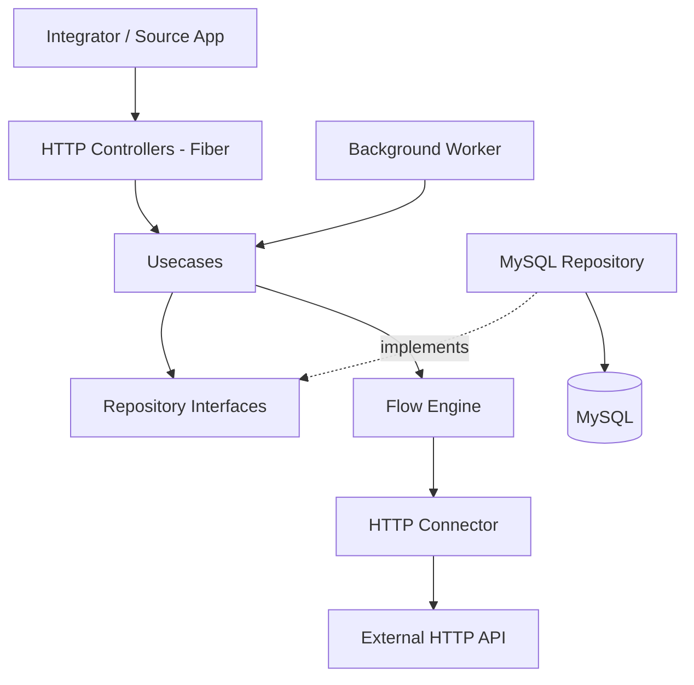
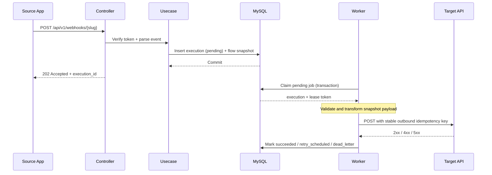
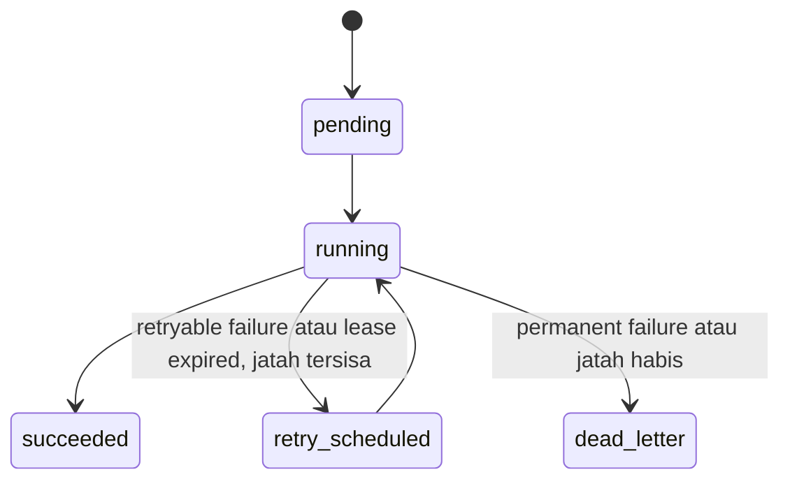

# AlurJet — System Design (Simplified)

> **Target:** proyek portofolio **mid-level backend developer**, bukan ESB enterprise.
> **Status:** spesifikasi rancangan untuk v0.1.0, belum implementasi.
> **Updated:** 2026-11-23

## 1. Tujuan dan ruang lingkup

MVP menyelesaikan satu kasus nyata: **webhook diterima -> JSON divalidasi -> field di-mapping -> POST ke API tujuan -> status bisa ditelusuri**. Jika HTTP tujuan gagal sementara, worker mencoba lagi. Setelah percobaan habis, execution berstatus `dead_letter` dan dapat di-replay manual.

**Masuk MVP:** YAML flow linear, CRUD flow sederhana, webhook, worker, retry, DLQ, execution history, API key dasar, logging, Swagger, tests, Docker Compose.

**Di luar MVP:** multi-tenant/RBAC, visual builder, message broker, custom scripting/CEL, scheduler, connector SDK, microservices, distributed tracing, management dashboard.

## 2. Teknologi

| Area | Pilihan | Alasan |
|---|---|---|
| Backend | Go + Fiber | HTTP API sederhana; framework hanya digunakan di controller |
| Database | MySQL 8+ (InnoDB) | Menyimpan flow, execution, dan background jobs |
| DB access | `database/sql` + MySQL driver | Query eksplisit, mudah diuji; `sqlc` opsional |
| Migration | golang-migrate | Schema dapat di-versioning |
| Jobs | Polling MySQL | Tidak membutuhkan Redis/NATS sejak awal |
| Config | YAML | Mudah dibaca dan dibagikan pengguna |
| Docs | Swaggo + Markdown | API contract dan panduan penggunaan |
| Logging | `log/slog` (JSON) | Korelasi error tanpa stack observability besar |
| Testing | `go test` + integration test MySQL | Bukti logic dan transaksi benar |
| Deploy | Docker Compose | Mudah direproduksi oleh reviewer |

Tetapkan versi dependency di `go.mod` dan dokumentasikan kompatibilitas ketika implementasi. Tidak perlu mengadopsi banyak library sekaligus.

## 3. Arsitektur



### Aturan setiap layer

- **Controllers:** baca request, middleware, validasi DTO, panggil usecase, ubah result/error menjadi HTTP response. Tidak ada SQL atau aturan retry di sini.
- **Usecases:** orchestration `CreateFlow`, `IngestWebhook`, `GetExecution`, `ReplayExecution`, `ProcessExecution`; tidak mengimpor Fiber atau driver MySQL.
- **Repositories:** implement interface persistence dari usecase/domain, menangani query dan transaksi; tidak memutuskan HTTP response.
- **Engine:** menjalankan step `validate`, `transform`, `http` berurutan; terpisah agar mudah unit test.
- **Worker:** polling execution siap proses, memanggil `ProcessExecution` dan mencatat status. Bisa dijalankan melalui binary yang sama dalam mode `worker`.

Gunakan **dependency injection manual** di startup; tidak perlu DI framework atau layer tambahan yang tidak memberi nilai.

### Bootstrap Compose dari volume kosong

- Gunakan variabel `ALURJET_MYSQL_HOST`, `ALURJET_MYSQL_PORT`, `ALURJET_MYSQL_DATABASE`, `ALURJET_MYSQL_USER`, dan `ALURJET_MYSQL_PASSWORD` sebagai sumber tunggal konfigurasi. Compose memetakan database, user, dan password dari variabel yang sama ke `MYSQL_DATABASE`, `MYSQL_USER`, dan `MYSQL_PASSWORD` pada service `mysql`. Untuk inisialisasi demo, Compose memetakan `ALURJET_MYSQL_ROOT_PASSWORD` ke `MYSQL_ROOT_PASSWORD` hanya pada service `mysql`. Password root berbeda dari kredensial aplikasi. API, worker, dan migrator membangun koneksi dari nilai `ALURJET_MYSQL_*` yang sama. Driver aplikasi memakai waktu UTC dan membaca kolom waktu sebagai timestamp Go.
- Compose menunggu healthcheck MySQL yang dapat menjalankan query ringan pada database yang dikonfigurasi. Setelah itu, service `migrate` satu kali menerapkan SQL versioned dengan golang-migrate dan keluar `0` pada sukses atau no-op. Error migrasi keluar nonnol dan terlihat di status/log service tanpa mencetak kredensial. API dan worker bergantung pada `migrate` dengan `condition: service_completed_successfully`. Keduanya tidak menjalankan migrasi saat startup.
- Jalur normal dari root adalah `docker compose up --build -d`. Jalankan ulang dengan volume yang sama untuk menguji no-op. Jalankan skenario bootstrap dan migrasi gagal pada project Compose serta volume test terisolasi.

### Struktur direktori target

```text
cmd/alurjet/main.go
internal/
  config/
  domain/                 # model, error, repository interfaces
  controllers/            # Fiber handlers, middleware, DTO
  usecases/               # business logic
  repositories/mysql/     # SQL dan transaksi
  engine/                 # parser, validation, transform, runner
  connectors/http/        # outbound HTTP client
  worker/                 # poll, claim, retry, recovery
migrations/
docs/
  examples/              # Fixture YAML dan JSON
tests/integration/
README.md
AGENTS.md
SYSTEM_DESIGN.md
ROADMAP.md
CONTRIBUTING.md
.env.example
Dockerfile
docker-compose.yml
```

## 4. Data model minimal

| Tabel | Kolom penting | Fungsi |
|---|---|---|
| `flows` | `id`, `slug` (unique), `name`, `definition_yaml`, `compiled_definition_json`, `created_at`, `updated_at` | YAML asli dan definisi aktif yang sudah divalidasi, berisi URL teresolusi dan default |
| `executions` | `id`, `flow_id`, `event_id` (nullable), `payload_json`, `payload_hash`, `flow_snapshot`, `outbound_idempotency_key`, `replayed_from_id` (nullable, FK ke `executions.id`), `replay_request_key` (nullable), `status`, `attempts`, `available_at` (NOT NULL), `lease_until`, `lease_token`, `last_error`, timestamps | Durable queue, state, dan asal replay |
| `execution_attempts` | `id`, `execution_id`, `attempt_no`, `lease_token`, `status`, `http_status`, `error_code`, `started_at`, `finished_at` | Riwayat eksekusi dengan status `running`, `succeeded`, `failed`, atau `lease_expired` |

Buat `UNIQUE(flow_id, event_id)`, `UNIQUE(replayed_from_id, replay_request_key)`, dan `UNIQUE(execution_id, attempt_no)`. Simpan event ID dan replay request key dengan perbandingan byte yang case-sensitive. Tambahkan indeks `executions(status, available_at, id)` dan `executions(status, lease_until, id)` untuk worker, serta `executions(flow_id, status)` untuk pemeriksaan kapasitas per flow. Simpan waktu dalam UTC dengan presisi milidetik. MVP tidak memerlukan tabel job, client, atau secret terpisah. Simpan `payload_json` sebagai teks JSON UTF-8 yang sudah divalidasi (misalnya `LONGTEXT`) agar penyimpanan mempertahankan token angka asli. MySQL tidak perlu melakukan query terhadap isi payload.

`POST` dan `PUT` menyimpan YAML asli serta definisi terkompilasi dalam satu transaksi. Ingest menyalin definisi terkompilasi sebagai snapshot dari satu versi flow yang sudah commit. Perubahan YAML atau environment baru berlaku setelah flow diimpor atau diperbarui. Pemeriksaan keamanan jaringan tetap memakai kebijakan yang saat ini aktif saat dispatch.

## 5. Proses webhook dan worker



### Ingest dan deduplikasi

1. Cocokkan token yang terikat pada slug route, lalu periksa ukuran, `Content-Type`, `X-Event-ID`, dan pastikan body berisi tepat satu objek JSON UTF-8. Tolak nama field berulang di setiap objek, termasuk objek bersarang dan anggota objek di dalam array. Bandingkan nama setelah decoding escape JSON secara case-sensitive. Kembalikan `400 INVALID_JSON` sebelum deduplikasi atau insert jika pemeriksaan gagal. Hitung SHA-256 dari byte body asli tanpa serialisasi ulang. Validasi field bisnis dijalankan oleh worker.
2. Setelah autentikasi dan validasi, periksa deduplikasi dan kapasitas sesuai bagian berikut. Simpan execution baru `pending` dengan `attempts=0` dan `available_at` dari `UTC_TIMESTAMP(3)` dalam transaksi insert. Simpan snapshot dan outbound idempotency key dari ID execution tersebut. Kembalikan `202` setelah commit. Worker dapat mengklaim row itu pada polling pertama setelah commit.
3. Jika unique key `(flow_id, event_id)` bertabrakan, baca execution existing yang sudah commit tanpa mengubahnya. Hash sama mengembalikan `202` dengan ID yang sama dan status dari hasil pembacaan itu. Hash berbeda mengembalikan `409 EVENT_ID_CONFLICT`. Pengirim harus mengulang byte body yang sama, termasuk whitespace. Unique key adalah pengaman untuk request serentak.

### Kapasitas penerimaan execution

- Kebijakan kapasitas dibuat untuk webhook pada M2 dan dipakai ulang untuk replay saat endpoint itu tersedia pada M3. Hitung `pending`, `running`, dan `retry_scheduled` sebagai execution aktif. Status terminal melepas kapasitas untuk pekerjaan baru.
- Gunakan transaksi MySQL `READ COMMITTED`. Lock row flow, lalu periksa deduplikasi dari hasil yang sudah commit dan baru periksa kapasitas untuk insert baru. Ingest mengambil snapshot dari flow yang dikunci. Replay memakai snapshot dan flow ID sumber. Jika operasi juga perlu mengunci execution, urutannya flow → execution. Claim, recovery, dan finalisasi tetap mengunci execution tanpa mengambil lock flow.
- `ALURJET_MAX_ACTIVE_PER_FLOW` membatasi execution aktif secara ketat per flow. Setiap insert baru melewati lock flow sehingga webhook dan replay concurrent berbagi kuota yang sama. Pada batas ini, kembalikan `429 FLOW_CAPACITY_EXCEEDED`.
- `ALURJET_ACTIVE_HIGH_WATERMARK` adalah ambang operasional global. Pada batas itu, hentikan insert baru dengan `503 SYSTEM_BACKPRESSURE`. Insert concurrent pada flow berbeda dapat melewati ambang sementara. Jika kedua batas tercapai, prioritaskan `503`. Gunakan `Retry-After` dalam detik untuk kedua error kapasitas. Mulai dari probe menggunakan indeks dan berhenti setelah batas tercapai. Ukur query plan dan lock wait sebelum menambah counter.
- Deduplikasi yang sudah commit tetap memberi `202` dengan execution ID yang sama meski antrean penuh. Event ID yang sama dengan body berbeda tetap `409 EVENT_ID_CONFLICT`. Request yang ditolak kapasitas dapat diulang dengan key dan body yang sama. API membaca status dan worker memproses execution yang sudah diterima seperti biasa. Uji dua jalur saat target offline.

### Claim, finalisasi, dan recovery

1. Saat slot worker tersedia, cari satu `pending` atau `retry_scheduled` yang sudah due dan masih punya jatah, urutkan berdasarkan `available_at, id`, lalu lock dengan `SELECT ... FOR UPDATE SKIP LOCKED`. Setelah lock, baca `SELECT UTC_TIMESTAMP(3)` sebagai statement terpisah pada transaksi yang sama. Gunakan nilai itu sebagai `db_now`, termasuk untuk menetapkan `lease_until = db_now + lease_duration`.
2. Dalam transaksi claim, ubah status menjadi `running`, naikkan `attempts` satu kali, buat token baru, dan buat attempt `running` dengan nomor dan token yang sama. Commit sebelum menjalankan engine atau koneksi HTTP. Selalu lock execution sebelum attempt dalam transaksi yang menyentuh keduanya.
3. Batasi seluruh attempt dengan `ALURJET_WORKER_ATTEMPT_TIMEOUT`, termasuk waktu commit claim dan I/O. Mulai mengukur durasi secara monotonic sebelum query waktu MySQL pada claim. Setelah commit, jangan jalankan engine jika anggaran sudah habis. Timeout HTTP efektif adalah nilai terkecil antara timeout step dan sisa anggaran attempt. Saat startup, wajibkan durasi `0 < attempt_timeout < lease_duration`. Nilai awal adalah 5 detik untuk HTTP, 15 detik untuk attempt, dan 60 detik untuk lease. MVP menggunakan lease tetap dengan satu step HTTP. Hentikan I/O saat context batal. Finalisasi menggunakan context DB terpisah yang berbatas waktu agar timeout handler tetap dapat dicatat.
4. Untuk semua hasil, lock kembali row execution berdasarkan ID, lalu ambil `db_now` dari MySQL setelah lock. Finalisasi hanya sah dengan guard berikut.

```sql
WHERE id = ?
  AND status = 'running'
  AND lease_token = ?
  AND lease_until > ?  -- db_now setelah lock
```

5. Jika guard ditolak, rollback dan kembalikan `ErrLostLease` tanpa mengubah execution maupun attempt atau mencatat event transisi. Error query/commit diperlakukan sebagai error infrastruktur. Jika guard lolos, tulis status execution dan attempt terkait, hasil/error, serta jadwal retry bila perlu, lalu kosongkan lease dalam satu transaksi. Rollback jika attempt aktif yang cocok tidak ditemukan. Keabsahan lease ditentukan pada saat keputusan setelah lock, termasuk bila commit selesai setelah expiry.
6. Recovery minimum wajib mulai M2. Worker memindai lease expired dengan batch terbatas saat startup dan berkala, terlepas dari ada atau tidaknya claim baru. Recovery memilih kandidat `running` dengan lease kedaluwarsa dan menguncinya dengan `SKIP LOCKED`. Periksa lagi status, token, dan `lease_until <= db_now` setelah lock, memakai waktu MySQL baru. Tutup attempt aktif sebagai `lease_expired` dan kosongkan lease. Jika `attempts < maxAttempts`, pindahkan ke `retry_scheduled` dengan backoff. Jika jatah habis, pindahkan ke `dead_letter`. Recovery tidak menaikkan `attempts`. Simpan semua perubahan dalam satu transaksi. Claim berikutnya memakai token dan nomor attempt baru.
7. Event transisi hanya dicatat setelah transaksi terkait berhasil commit.

### Batas ukuran JSON keluar

Terapkan `ALURJET_MAX_OUTBOUND_BYTES` pada output setiap `transform` dan body final, termasuk flow tanpa transform. Pada setiap step, bangun objek UTF-8 secara bertahap dalam buffer berbatas. Periksa sisa anggaran sebelum menambahkan key yang telah di-escape, tanda baca, atau fragmen nilai. Referensikan fragmen JSON valid dari input step agar satu nilai yang dipetakan berulang dapat diukur sebelum disalin. Jangan serialisasi seluruh objek ke buffer sementara sebelum pemeriksaan. Pertahankan token angka asli dan gunakan urutan key deterministik. Tepat pada batas diterima. Input tetap tunduk pada `ALURJET_MAX_PAYLOAD_BYTES` dan boleh lebih besar dari batas outbound jika transform pertama mengecilkannya.

Jika step mana pun melebihi batas, hentikan execution sebelum step berikutnya, resolusi DNS, atau koneksi HTTP. Finalisasi attempt sebagai gagal permanen dengan `OUTBOUND_PAYLOAD_TOO_LARGE` dan execution `dead_letter`. Jangan isi status HTTP target dan jangan jadwalkan ulang. Nilai awal batas adalah 1 MiB, dengan konfigurasi positif yang diperiksa saat startup.

### Klasifikasi hasil dan retry

Batasi header respons target melalui `Transport.MaxResponseHeaderBytes` dengan `ALURJET_MAX_RESPONSE_HEADER_BYTES` (contoh 64 KiB). Setelah memperoleh status final, klasifikasikan dari status dan tutup `response.Body` tanpa membaca, menyimpan, atau mencatat isinya pada MVP. Gunakan context attempt yang sudah dibatasi waktu. Respons `2xx` tetap sukses ketika body besar atau lambat. Jika transport gagal sebelum status valid, gunakan klasifikasi transport yang ada dan kosongkan `http_status`. Jika kelak integrasi memerlukan body, tetapkan batas byte tetap untuk pembacaan sebelum mengaktifkannya.

Implementasikan keputusan sukses, retry, dan gagal permanen bersama finalisasi M2. Jika hasilnya retryable dan masih ada jatah, finalisasi menutup attempt saat ini dan menyimpan `retry_scheduled` serta `available_at` dalam satu transaksi. Poller M2 hanya mengklaim retry saat due. M2 juga memulihkan lease kedaluwarsa. M3 memperluas verifikasi recovery serentak, retry berulang, riwayat, dan replay.

- HTTP `2xx` menyelesaikan execution. HTTP `408`, `429`, `5xx`, timeout, dan kegagalan transport sementara mencoba lagi bila jatah tersedia.
- Error validasi atau mapping, `OUTBOUND_PAYLOAD_TOO_LARGE`, penolakan keamanan outbound, kegagalan verifikasi TLS, respons HTTP di luar `2xx`/`408`/`429`/`5xx`, dan error transport yang tidak diklasifikasikan sementara bersifat permanen. Hasil retryable dengan jatah habis juga berakhir sebagai `dead_letter`.
- Backoff untuk attempt gagal ke-`n` adalah `initialDelay × 2^(n-1)`, dengan cap 60 detik. Hitung `available_at` dari waktu keputusan MySQL. Default 3 attempts dan jeda 2 detik lalu 4 detik. Percobaan pertama dihitung saat claim.

### Replay

Hanya execution `dead_letter` yang dapat di-replay. Replay menyalin payload, snapshot, dan outbound idempotency key dari execution asal, membuat execution `pending` dengan `attempts=0` dan `available_at` dari `UTC_TIMESTAMP(3)` pada transaksi insert, dan menyimpan `replayed_from_id` ke execution yang diminta. Replay tidak membawa `event_id`, sehingga unique key webhook tetap terpisah. `Idempotency-Key` pada request replay wajib dan scoped ke ID asal. Insert pertama menerapkan kebijakan kapasitas flow asal dan mengembalikan `202` setelah commit. Request serentak atau ulang dengan key yang sama diperiksa sebelum kapasitas dan mengembalikan ID replay yang sama melalui unique key. Key baru membuat execution baru yang tetap menggunakan outbound idempotency key asal. Jika payload atau flow perlu diganti, kirim event baru dengan `X-Event-ID` baru.

### State machine



**Semantik at-least-once:** kirim header `Idempotency-Key` dari `outbound_idempotency_key` pada setiap POST, termasuk retry dan replay. Request bisa dikirim lagi setelah timeout atau crash. Pencegahan efek ganda bergantung pada kontrak idempotensi target dan masa berlakunya.

## 6. Flow DSL (MVP)

```yaml
apiVersion: alurjet/v1
kind: Flow
metadata:
  name: Order to API
  slug: order-to-api
spec:
  trigger:
    type: webhook
  steps:
    - id: validate
      type: validate
      required: [order_id, total]
    - id: mapping
      type: transform
      fields:
        orderNumber: "$.order_id"
        amount: "$.total"
    - id: forward
      type: http
      method: POST
      url: "${ALURJET_FLOW_TARGET_URL}/orders"
      timeout: 5s
  retry:
    maxAttempts: 3
    initialDelay: 2s
```

- Flow berisi 1–10 step, tepat satu `http` di posisi terakhir, dan ID step unik. Step sebelumnya hanya `validate` atau `transform`. Setiap attempt menjalankan flow dari payload snapshot awal.
- Mapping hanya menerima `$.field` atau `$.object.field`. Data hasil `transform` diteruskan ke step berikutnya. Pertahankan token angka JSON dari ingest, penyimpanan, dan pemetaan sampai serialisasi outbound. Di Go, gunakan nilai seperti `json.RawMessage` atau `json.Number` dan hindari konversi angka ke `float64`.
- Resolve placeholder dengan prefix `ALURJET_FLOW_` saat create/update. Placeholder yang tidak didukung atau bernilai kosong membuat konfigurasi ditolak.
- Terapkan batas ukuran body dan kebijakan outbound di §8.

Spesifikasi detail: [docs/guides/flow-configuration.md](docs/guides/flow-configuration.md).

## 7. REST API (target kontrak)

| Method | Path | Fungsi |
|---|---|---|
| `GET` | `/healthz` | Health check |
| `POST` | `/api/v1/flows` | Import YAML flow |
| `GET` | `/api/v1/flows` | List flow |
| `GET` | `/api/v1/flows/{slug}` | Detail flow |
| `PUT` | `/api/v1/flows/{slug}` | Update YAML flow |
| `POST` | `/api/v1/webhooks/{slug}` | Terima event -> `202` |
| `GET` | `/api/v1/executions` | List/filter executions |
| `GET` | `/api/v1/executions/{id}` | Status dan attempt history |
| `POST` | `/api/v1/executions/{id}/replay` | Replay dead-letter execution |
| `GET` | `/swagger/index.html` | Swagger UI (development) |

Management API memakai `Authorization: Bearer <ALURJET_ADMIN_API_KEY>`. Webhook memakai header `X-Webhook-Token` dengan token khusus slug dan `X-Event-ID`. Operator memasok objek JSON `ALURJET_WEBHOOK_TOKENS_JSON` ke proses API dengan key slug dan value token. Tolak JSON invalid, slug duplikat, token kosong, token yang sama untuk beberapa slug, dan token yang sama dengan admin key. Flow dapat diimpor sebelum token tersedia. Request tanpa binding atau dengan token salah mendapat `401` generik sebelum lookup flow atau deduplikasi. Setelah token valid, flow yang belum ada tetap mengikuti `404`. Token dikelola terpisah dari YAML, snapshot, dan worker.

Lihat [referensi API](docs/reference/api.md) untuk kontrak dan contoh request, serta [referensi error HTTP](docs/reference/errors.md).

## 8. Security & logging yang cukup untuk MVP

- Rahasiakan API key/token lewat `.env` dan jangan commit nilainya; aktifkan HTTPS melalui reverse proxy di lingkungan publik.
- Gunakan perbandingan token yang aman terhadap timing pada binding slug yang tepat; batasi body size, timeout, jumlah step, dan concurrency worker.
- Saat create/update, izinkan URL absolut dengan origin yang cocok persis dengan `ALURJET_ALLOWED_ORIGINS` (skema, hostname, dan port efektif). Tolak userinfo dan fragmen. Gunakan HTTPS untuk target biasa. Ulangi pengecekan origin dengan kebijakan aktif sebelum dispatch, termasuk untuk retry dan replay snapshot lama.
- Gunakan resolver/dialer yang memeriksa IP saat koneksi dibuat, menolak alamat yang tidak dapat dirutekan secara publik (termasuk private, loopback, link-local, carrier-grade NAT, multicast, dan alamat khusus/reserved; normalisasi IPv4-mapped IPv6 sebelum klasifikasi), dan membuka koneksi langsung ke IP yang lolos tanpa resolusi kedua. Pertahankan hostname URL asli untuk HTTP Host dan verifikasi TLS. Tolak DNS yang mengembalikan kombinasi alamat yang diizinkan dan dilarang. Nonaktifkan redirect dan penggunaan proxy dari environment pada client outbound.
- Profil Compose demo boleh mengizinkan origin HTTP dan IP privat hanya untuk satu origin yang tercantum pada `ALURJET_DEV_PRIVATE_ORIGIN` **dan** allowlist. Default runtime untuk pengecualian ini kosong. Loopback, link-local, alamat metadata, multicast, dan unspecified tetap ditolak. Bind port demo yang dipublikasikan ke loopback; mock receiver hanya perlu tersedia di jaringan Compose.
- Logging JSON via `slog`: `event`, `execution_id`, `flow_slug`, `attempt`, `duration_ms`, `error_code`.
- Jangan mencatat `Authorization`, webhook token, atau payload mentah secara default.
- Error response ke user memakai `code` dan `message` yang tidak mengandung credential/stack trace.
- Integrasi ini demo self-hosted; jangan menganggapnya enterprise-ready.

## 9. Testing minimum

| Jenis | Kasus penting |
|---|---|
| Unit | YAML invalid, missing field, mapping, retry policy, error classification |
| Controller | Auth header valid/invalid, request body error, status codes |
| Bootstrap | Volume kosong; migrasi sukses dan no-op setelah startup ulang; kegagalan migrasi terlihat dan menahan API/worker |
| Batas tiap transform dan body final | Tepat pada batas diteruskan; satu byte di atas batas menghasilkan dead-letter tanpa DNS. Uji field yang dipetakan berulang, UTF-8/escaping, hasil intermediate yang akan diperkecil step berikutnya, dan flow tanpa transform |
| Repository integration | Migration; ingest serentak dengan ID/payload sama atau berbeda; rollback bila insert attempt gagal; satu claim per execution; webhook baru dan replay dapat diambil pada polling pertama setelah commit; concurrent replay dengan key sama |
| E2E | Webhook → transform → POST, termasuk integer `9007199254740993` dan desimal `0.123456789012345678901` yang harus keluar sebagai token angka JSON yang sama; bandingkan token atau gunakan `json.Number`, tanpa `float64`; 500 → 200; selalu 500 → dead-letter; replay memakai snapshot dan key asal meskipun flow aktif berubah |
| Kapasitas webhook dan replay | Target offline; isi antrean dengan status aktif, ulangi event/replay yang sudah commit, lalu uji webhook dan replay concurrent pada flow yang sama. Pastikan pekerjaan terminal melepas slot |
| Respons target terbatas | Uji `200` dengan body besar atau lambat, respons dengan header melebihi batas, dan pelepasan slot. Worker tidak menggunakan body untuk hasil atau log |
| Recovery M2 | Crash setelah mock menerima POST, sebelum finalisasi. Setelah lease expired, tutup attempt sekali, lalu retry dengan body dan outbound key yang sama atau dead-letter saat jatah habis. Tolak finalisasi saat lease habis sebelum recovery walau token sama; uji tepat pada batas expiry; lock wait yang melewati expiry; crash pada attempt terakhir → `dead_letter`; dua worker recovery menutup attempt lama sekali |
| HTTP outbound | Origin ditolak, redirect tidak diikuti, DNS publik/privat campuran ditolak, IP koneksi sama dengan IP yang divalidasi, pengecualian origin mock tidak berlaku pada target lain |

Untuk race lease, seed state dengan waktu MySQL, gunakan waktu keputusan tetap pada unit test predicate, dan sinkronkan urutan lock dengan barrier/lock wait pada integrasi MySQL. Hindari `sleep` sebagai penentu urutan. Uji `lease_until == db_now` serta seluruh jalur finalisasi. Gunakan mock target dan resolver terkontrol untuk tes jaringan.

CI minimum menjalankan `go test ./...`, lint/format check, dan test integrasi MySQL (bisa job terpisah). Tidak perlu benchmark besar atau OpenTelemetry dalam MVP.

## 10. Trade-offs yang sengaja dipilih

- **MySQL queue** sederhana dan cukup untuk belajar concurrency/transaksi, tetapi bukan pengganti broker pada throughput tinggi.
- **Single admin key** lebih mudah untuk demo tetapi belum cocok untuk banyak tenant/team.
- **No UI**: Swagger, curl, dan execution API adalah antarmuka operasional awal.
- **Linear flow** lebih mudah dipahami dan diuji dibanding branching/scripting.

Lanjutkan implementasi melalui [ROADMAP.md](ROADMAP.md). Dokumentasi penggunaan tersedia di [docs/README.md](docs/README.md).
