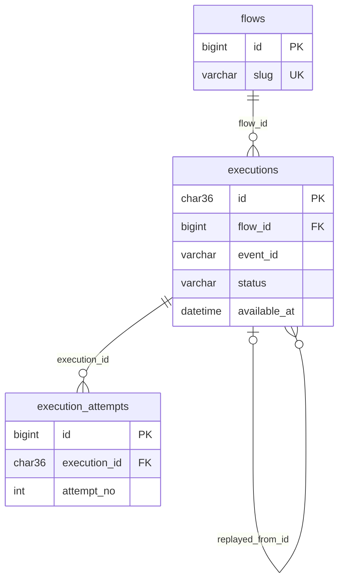

# Referensi database

> **Status rancangan.** DDL di bawah diterapkan pada MySQL 8.4.13 sekali pakai dan lulus (lihat [worklog](../ai/worklog.md)). Belum ada migrasi atau kode yang memakainya. Konteks keputusan ada di [ADR-004](../ai/decisions.md).

## Aturan umum

- Engine InnoDB, MySQL 8.4 LTS, charset tabel `utf8mb4`.
- Waktu memakai `DATETIME(3)` dalam UTC. Driver aplikasi memakai `parseTime=true` dan `loc=UTC`. Nilai waktu keputusan diambil dari `UTC_TIMESTAMP(3)` MySQL, bukan jam aplikasi.
- Kolom kunci yang dibandingkan case-sensitive (`slug`, `event_id`, `replay_request_key`, token, dan ID) memakai `CHARACTER SET ascii COLLATE ascii_bin`. Collation biner membuat `Order-1` dan `order-1` dianggap berbeda.
- `flows.id` adalah `BIGINT UNSIGNED` auto-increment. `executions.id` adalah UUID v4 dalam `CHAR(36)` huruf kecil, dibuat oleh aplikasi.
- `payload_json` dan `flow_snapshot` disimpan sebagai `LONGTEXT` agar token angka JSON asli tidak berubah. MySQL tidak mengkueri isinya.

## ERD



## DDL

```sql
CREATE TABLE flows (
  id                       BIGINT UNSIGNED NOT NULL AUTO_INCREMENT,
  slug                     VARCHAR(64) CHARACTER SET ascii COLLATE ascii_bin NOT NULL,
  name                     VARCHAR(255) NOT NULL,
  definition_yaml          MEDIUMTEXT NOT NULL,
  compiled_definition_json LONGTEXT NOT NULL,
  created_at               DATETIME(3) NOT NULL DEFAULT (UTC_TIMESTAMP(3)),
  updated_at               DATETIME(3) NOT NULL DEFAULT (UTC_TIMESTAMP(3)),
  PRIMARY KEY (id),
  UNIQUE KEY uq_flows_slug (slug)
) ENGINE=InnoDB DEFAULT CHARSET=utf8mb4;

CREATE TABLE executions (
  id                       CHAR(36) CHARACTER SET ascii COLLATE ascii_bin NOT NULL,
  flow_id                  BIGINT UNSIGNED NOT NULL,
  event_id                 VARCHAR(128) CHARACTER SET ascii COLLATE ascii_bin NULL,
  payload_json             LONGTEXT NOT NULL,
  payload_hash             CHAR(64) CHARACTER SET ascii COLLATE ascii_bin NOT NULL,
  flow_snapshot            LONGTEXT NOT NULL,
  outbound_idempotency_key VARCHAR(64) CHARACTER SET ascii COLLATE ascii_bin NOT NULL,
  replayed_from_id         CHAR(36) CHARACTER SET ascii COLLATE ascii_bin NULL,
  replay_request_key       VARCHAR(128) CHARACTER SET ascii COLLATE ascii_bin NULL,
  status                   VARCHAR(16) CHARACTER SET ascii NOT NULL,
  attempts                 SMALLINT UNSIGNED NOT NULL DEFAULT 0,
  available_at             DATETIME(3) NOT NULL,
  lease_until              DATETIME(3) NULL,
  lease_token              CHAR(36) CHARACTER SET ascii COLLATE ascii_bin NULL,
  last_error               VARCHAR(255) NULL,
  created_at               DATETIME(3) NOT NULL DEFAULT (UTC_TIMESTAMP(3)),
  updated_at               DATETIME(3) NOT NULL DEFAULT (UTC_TIMESTAMP(3)),
  PRIMARY KEY (id),
  UNIQUE KEY uq_exec_flow_event (flow_id, event_id),
  UNIQUE KEY uq_exec_replay (replayed_from_id, replay_request_key),
  KEY ix_exec_ready (status, available_at, id),
  KEY ix_exec_lease (status, lease_until, id),
  KEY ix_exec_flow_status (flow_id, status),
  CONSTRAINT fk_exec_flow FOREIGN KEY (flow_id) REFERENCES flows (id),
  CONSTRAINT fk_exec_replayed_from FOREIGN KEY (replayed_from_id) REFERENCES executions (id),
  CONSTRAINT ck_exec_status CHECK (status IN
    ('pending','running','retry_scheduled','succeeded','dead_letter'))
) ENGINE=InnoDB DEFAULT CHARSET=utf8mb4;

CREATE TABLE execution_attempts (
  id           BIGINT UNSIGNED NOT NULL AUTO_INCREMENT,
  execution_id CHAR(36) CHARACTER SET ascii COLLATE ascii_bin NOT NULL,
  attempt_no   SMALLINT UNSIGNED NOT NULL,
  lease_token  CHAR(36) CHARACTER SET ascii COLLATE ascii_bin NOT NULL,
  status       VARCHAR(16) CHARACTER SET ascii NOT NULL,
  http_status  SMALLINT UNSIGNED NULL,
  error_code   VARCHAR(64) CHARACTER SET ascii NULL,
  started_at   DATETIME(3) NOT NULL,
  finished_at  DATETIME(3) NULL,
  PRIMARY KEY (id),
  UNIQUE KEY uq_attempt_no (execution_id, attempt_no),
  CONSTRAINT fk_attempt_exec FOREIGN KEY (execution_id) REFERENCES executions (id),
  CONSTRAINT ck_attempt_status CHECK (status IN
    ('running','succeeded','failed','lease_expired'))
) ENGINE=InnoDB DEFAULT CHARSET=utf8mb4;
```

### Catatan

- `UNIQUE(flow_id, event_id)` dan `UNIQUE(replayed_from_id, replay_request_key)` mengizinkan banyak baris dengan nilai `NULL`. Execution hasil replay tidak membawa `event_id`, dan execution webhook tidak membawa `replayed_from_id`.
- `outbound_idempotency_key` dibuat dari ID execution pada ingest dan disalin apa adanya saat replay.
- `last_error` menyimpan kode error dan pesan singkat tanpa payload, token, atau nilai header.
- `status` berupa `VARCHAR` dengan `CHECK` agar migrasi status baru tidak memerlukan `ALTER` enum. MySQL 8.4 menegakkan `CHECK`.
- Kolom waktu memakai default ekspresi `(UTC_TIMESTAMP(3))`. Aplikasi tetap mengisi `available_at` secara eksplisit dari `UTC_TIMESTAMP(3)` pada transaksi insert.

## Query kunci

Detail alur ada di [desain sistem §5](../../SYSTEM_DESIGN.md). Bentuk query:

```sql
-- Claim (transaksi; lalu SELECT UTC_TIMESTAMP(3) sebagai db_now)
SELECT id FROM executions
WHERE status IN ('pending','retry_scheduled') AND available_at <= UTC_TIMESTAMP(3)
ORDER BY available_at, id
LIMIT 1
FOR UPDATE SKIP LOCKED;

-- Recovery (batas ALURJET_WORKER_RECOVERY_BATCH)
SELECT id FROM executions
WHERE status = 'running' AND lease_until <= UTC_TIMESTAMP(3)
ORDER BY lease_until, id
LIMIT ?
FOR UPDATE SKIP LOCKED;

-- Kuota per flow (setelah lock row flow)
SELECT COUNT(*) FROM (
  SELECT 1 FROM executions
  WHERE flow_id = ? AND status IN ('pending','running','retry_scheduled')
  LIMIT ?          -- ALURJET_MAX_ACTIVE_PER_FLOW
) AS t;
```

Setelah recovery memilih kandidat, periksa ulang status, token, dan `lease_until <= db_now` dengan waktu MySQL baru, seperti dijelaskan di desain.

## Pertumbuhan data dan retensi

MVP tidak menghapus data. `payload_json` dan `flow_snapshot` disimpan sebagai teks biasa, sehingga tabel `executions` tumbuh seiring jumlah event dan payload dapat berisi data pribadi. Dedup berlaku selama baris masih ada. Retensi dan masa dedup dijadwalkan di [backlog pasca-MVP](../post-mvp.md). Untuk demo, bersihkan dengan `docker compose down -v`. Rencanakan backup `mysqldump` sebelum memakai data nyata.

[Kembali ke indeks dokumentasi](../README.md)
